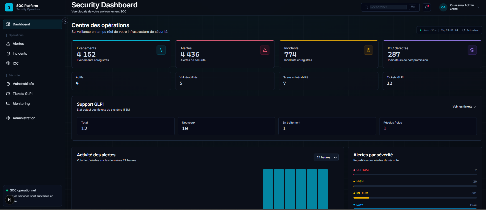
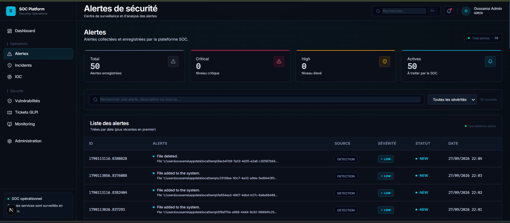
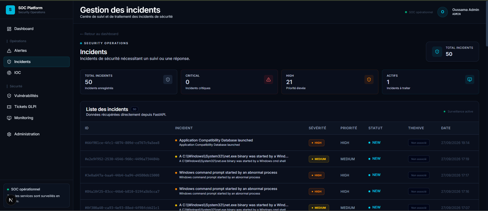
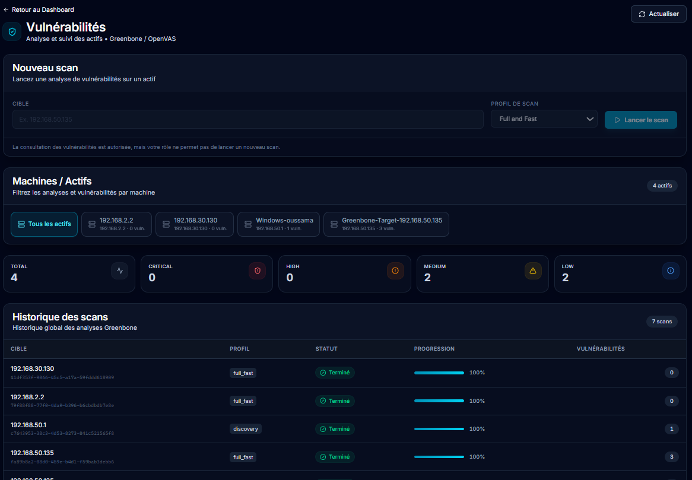
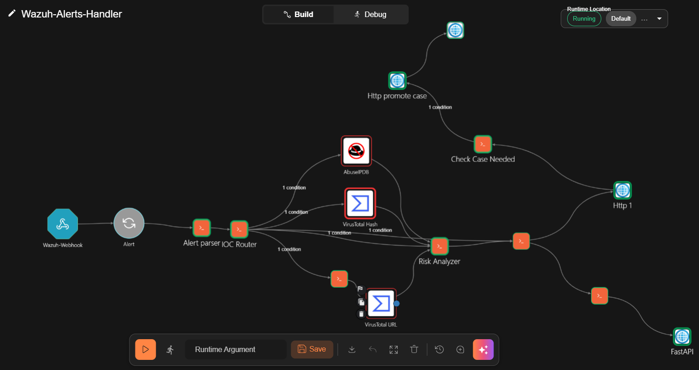
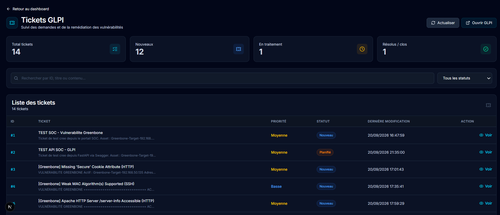
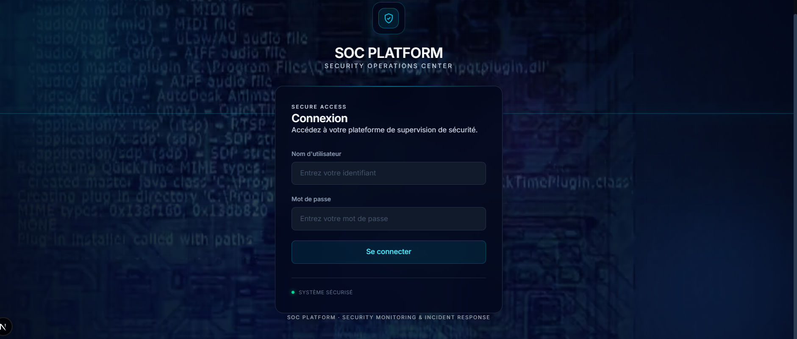

# SOC/SIEM Modular Platform

> Plateforme web modulaire de supervision de sécurité, de centralisation
> des alertes, de gestion des incidents et de suivi des vulnérabilités.

Projet réalisé dans le cadre d'un stage d'application chez **AFRISCON
SARL**.


## Sommaire

-   [Présentation](#présentation)
-   [Objectifs](#objectifs)
-   [Fonctionnalités](#fonctionnalités)
-   [Architecture générale](#architecture-générale)
-   [Technologies et intégrations](#technologies-et-intégrations)
-   [Organisation du dépôt](#organisation-du-dépôt)
-   [Prérequis](#prérequis)
-   [Installation et configuration](#installation-et-configuration)
-   [Démarrage](#démarrage)
-   [API](#api)
-   [Sécurité et limites](#sécurité-et-limites)
-   [Captures d'écran](#captures-décran)
-   [Perspectives](#perspectives)
-   [Auteur](#auteur)
-   [Licence](#licence)

------------------------------------------------------------------------

## Présentation

**SOC/SIEM Modular Platform** est une plateforme destinée à faciliter
les opérations quotidiennes d'un centre opérationnel de sécurité (SOC).
Elle fournit une interface centralisée pour consulter les événements et
alertes collectés par **Wazuh**, suivre les incidents, gérer les
indicateurs de compromission (IOC), consulter les résultats de scans de
vulnérabilités et suivre les actions de remédiation.

Le projet associe une interface web à une API backend qui communique
avec les différents outils de sécurité. Il s'appuie sur des composants
open source et des intégrations externes afin de proposer une chaîne de
supervision et de réponse modulaire.

La solution comprend principalement deux applications :

  -----------------------------------------------------------------------
  Composant               Technologies            Responsabilité
  ----------------------- ----------------------- -----------------------
  `soc_backend`           FastAPI, SQLAlchemy,    API REST,
                          Pydantic                authentification,
                                                  logique métier et
                                                  intégrations

  `soc-frontend`          Next.js, React,         Interface web destinée
                          Tailwind CSS            aux analystes SOC

  Base de données         MariaDB                 Stockage des données
                                                  applicatives
  -----------------------------------------------------------------------

## Objectifs

-   Centraliser dans une interface unique les informations utiles aux
    opérations SOC.
-   Faciliter la consultation et le suivi des alertes de sécurité.
-   Structurer le traitement des incidents et leur suivi.
-   Mettre à disposition des informations de threat intelligence pour
    l'analyse des IOC.
-   Intégrer la gestion des vulnérabilités et le suivi de leur
    remédiation.
-   Automatiser certaines étapes de traitement et de réponse lorsque les
    intégrations sont configurées.
-   Contrôler l'accès aux fonctionnalités selon les rôles et
    permissions.

## Fonctionnalités

### Supervision et détection

-   Tableau de bord présentant les indicateurs de supervision
    disponibles.
-   Consultation des événements et alertes remontés par Wazuh.
-   Consultation des informations de sécurité par catégories disponibles
    dans l'application.
-   Association des alertes et événements aux tactiques et techniques
    MITRE ATT&CK lorsque les données de correspondance sont disponibles.

### Gestion des incidents

-   Création et suivi des incidents depuis la plateforme.
-   Consultation du statut et des informations de traitement.
-   Création de cases dans **TheHive** par les workflows **Shuffle** et
    par l'intégration déclenchée depuis le portail, selon le parcours
    utilisé.

### Threat intelligence et IOC

-   Gestion des indicateurs de compromission : adresses IP, domaines,
    URLs et empreintes de fichiers, selon les types pris en charge.
-   Intégration de **VirusTotal** et **AbuseIPDB** pour consulter des
    informations de réputation.
-   Les résultats d'enrichissement dépendent de la disponibilité des
    services externes, de leurs API et de la configuration locale.

### Gestion des vulnérabilités

-   Intégration de **Greenbone/OpenVAS** au moyen d'un adaptateur REST.
-   Lancement et suivi des scans selon la configuration de
    l'intégration.
-   Consultation des résultats et des vulnérabilités remontées.
-   Création de tickets **GLPI** à partir des vulnérabilités afin de
    faciliter le suivi de leur remédiation.

### Réponse et automatisation

-   Intégration de **Shuffle SOAR** pour l'automatisation de workflows
    de traitement d'alertes.
-   Intégration des mécanismes de réponse de Wazuh lorsque ceux-ci sont
    configurés et autorisés.
-   Possibilité de préparer ou simuler certaines actions avec un mode
    `DRY_RUN`, selon la configuration.

> Les actions de réponse peuvent avoir un impact sur les systèmes
> supervisés. Elles doivent être testées dans un environnement contrôlé
> et activées uniquement après validation.

### Administration et contrôle d'accès

-   Authentification par JWT.
-   Gestion des utilisateurs, rôles et permissions (RBAC).
-   Contrôle d'accès aux fonctionnalités de la plateforme.
-   Journalisation des actions applicatives lorsque cette fonctionnalité
    est activée.

### Visualisation

-   Intégration de tableaux de bord Grafana dans l'interface, selon la
    configuration.

## Architecture générale

Le schéma ci-dessous présente les principaux composants et les flux
d'intégration. Il s'agit d'une vue logique : les adresses, ports et
modalités de déploiement dépendent de l'environnement utilisé.

``` text
       Sources de sécurité
  +-----------------------------+
  | Windows endpoints           |
  | Suricata                    |
  | FortiGate                   |
  +--------------+--------------+
                 |
                 v
        +------------------+
        | Wazuh Manager    |
        | Wazuh Indexer    |
        +--------+---------+
                 |
        Alertes / événements
                 |
        +--------v---------+
        | Shuffle SOAR     |
        | Workflows        |
        +--------+---------+
                 |
                 v
        +------------------+
        | TheHive          |
        | Gestion des cases|
        +------------------+


       Analyste SOC
            |
            v
  +-------------------------+
  | Frontend Next.js        |
  +------------+------------+
               | REST / JWT
               v
  +-------------------------+
  | Backend FastAPI         |
  | Logique métier          |
  | Intégrations            |
  +---+------+------+---+---+
      |      |      |   |
      v      v      v   v
   MariaDB  GLPI  Greenbone  Threat
            |     Adapter   Intelligence
            |                |
            v                +-- VirusTotal
       Tickets GLPI           +-- AbuseIPDB

       Grafana
   Visualisation / monitoring
```

### Chaîne de traitement (vue simplifiée)

1.  Les équipements et systèmes supervisés produisent des événements de
    sécurité.
2.  Wazuh collecte et analyse les événements pour générer des alertes.
3.  Les alertes peuvent être transmises à Shuffle pour déclencher des
    workflows d'automatisation.
4.  Les workflows concernés peuvent créer des cases dans TheHive.
5.  L'analyste consulte les informations disponibles depuis le portail
    SOC et peut déclencher les opérations prévues par les intégrations.
6.  Les vulnérabilités identifiées peuvent être suivies et faire l'objet
    de tickets GLPI.

Le frontend communique avec le backend FastAPI. L'accès à la base
MariaDB est réalisé côté backend ; le navigateur ne se connecte pas
directement à la base de données.

## Technologies et intégrations

  -----------------------------------------------------------------------
  Domaine                 Outil / technologie     Rôle
  ----------------------- ----------------------- -----------------------
  Backend                 Python, FastAPI         API et logique métier

  ORM / validation        SQLAlchemy, Pydantic    Accès aux données et
                                                  validation

  Frontend                Next.js, React,         Interface web
                          Tailwind CSS            

  Base de données         MariaDB                 Persistance applicative

  SIEM                    Wazuh                   Collecte, analyse et
                                                  alerting

  NIDS                    Suricata                Détection d'événements
                                                  réseau

  Pare-feu                FortiGate               Sécurité et filtrage
                                                  réseau

  SOAR                    Shuffle                 Automatisation des
                                                  workflows

  Incident response       TheHive                 Gestion des cases

  Vulnérabilités          Greenbone / OpenVAS     Scans et évaluation des
                                                  vulnérabilités

  ITSM                    GLPI                    Gestion des tickets et
                                                  suivi de remédiation

  Threat intelligence     VirusTotal, AbuseIPDB   Informations de
                                                  réputation

  Monitoring              Grafana                 Visualisation et
                                                  tableaux de bord

  Référentiel             MITRE ATT&CK            Tactiques et techniques
                                                  adverses

  Conteneurisation        Docker                  Déploiement de
                                                  composants compatibles
  -----------------------------------------------------------------------

## Organisation du dépôt

La structure ci-dessous est indicative. Elle doit être ajustée si
l'arborescence réelle du dépôt évolue.

``` text
projet_soc/
├── README.md
├── .gitignore
├── GITHUB.md
├── soc_backend/
│   ├── app/
│   │   ├── main.py
│   │   ├── api/
│   │   ├── core/
│   │   ├── models/
│   │   ├── schemas/
│   │   └── services/
│   ├── alembic/
│   ├── tests/
│   ├── .env.example
│   ├── requirements.txt
│   ├── Dockerfile
│   └── docker-compose.yml
└── soc-frontend/
    ├── src/
    │   ├── app/
    │   ├── components/
    │   └── lib/
    ├── public/
    ├── .env.example
    ├── package.json
    └── next.config.mjs
```

## Prérequis

Les versions exactes doivent être confirmées à partir des fichiers de
dépendances du dépôt. Les versions ci-dessous reprennent les versions
indiquées dans la documentation initiale du projet.

  Outil     Version / remarque
  --------- -------------------------------------
  Python    3.11 ou supérieur
  Node.js   20 ou supérieur
  npm       10 ou supérieur
  MariaDB   10.4 ou supérieur
  Git       Version récente
  Docker    Selon le mode de déploiement choisi

Les services Wazuh, Shuffle, TheHive, GLPI, Greenbone/OpenVAS et Grafana
sont des intégrations externes. Ils ne sont pas nécessairement tous
requis pour démarrer l'interface et l'API en mode local, mais les
fonctionnalités correspondantes nécessitent leur disponibilité et leur
configuration.

## Installation et configuration

### 1. Cloner le dépôt

Remplacez l'URL par celle de votre dépôt GitHub :

``` bash
git clone https://github.com/Oussamaelhilali2025/soc-platform.git
cd soc-platform
```

### 2. Préparer la base de données

Créez une base MariaDB si elle n'existe pas déjà :

``` sql
CREATE DATABASE soc_platform
  CHARACTER SET utf8mb4
  COLLATE utf8mb4_unicode_ci;
```

Configurez ensuite les paramètres de connexion dans le fichier
d'environnement du backend. La création ou la mise à jour du schéma doit
suivre les migrations et la procédure réellement utilisées par le
projet.

### 3. Installer le backend

Depuis la racine du dépôt, sous Windows PowerShell :

``` powershell
cd soc_backend
python -m venv .venv
.\.venv\Scripts\Activate.ps1
pip install -r requirements.txt
Copy-Item .env.example .env
```

Sous Linux/macOS :

``` bash
cd soc_backend
python3 -m venv .venv
source .venv/bin/activate
pip install -r requirements.txt
cp .env.example .env
```

Éditez ensuite `soc_backend/.env` avec les paramètres de votre
environnement local. N'ajoutez jamais ce fichier au dépôt Git.

### 4. Installer le frontend

Depuis la racine du dépôt :

``` powershell
cd soc-frontend
npm install
Copy-Item .env.example .env.local
```

Sous Linux/macOS :

``` bash
cd soc-frontend
npm install
cp .env.example .env.local
```

Adaptez les URLs publiques du frontend à l'adresse de l'API et aux
interfaces externes réellement utilisées.

## Configuration

Les fichiers `.env` et `.env.local` sont réservés à la configuration
locale et ne doivent pas être versionnés. Les fichiers `.env.example`
documentent les variables nécessaires sans contenir de valeurs
sensibles.

### Variables backend

Les noms ci-dessous correspondent aux variables documentées dans la
configuration initiale. Vérifiez les fichiers `.env.example` et le code
de configuration pour connaître les variables effectivement requises par
la version publiée.

  -----------------------------------------------------------------------
  Variable                            Description
  ----------------------------------- -----------------------------------
  `SECRET_KEY`                        Clé secrète utilisée pour la
                                      signature des tokens

  `MYSQL_USER`, `MYSQL_PASSWORD`      Identifiants MariaDB

  `MYSQL_HOST`, `MYSQL_PORT`,         Paramètres de connexion MariaDB
  `MYSQL_DB`                          

  `BACKEND_CORS_ORIGINS`              Origines autorisées pour CORS

  `WAZUH_API_URL`                     URL de l'API Wazuh Manager

  `WAZUH_API_USER`,                   Identifiants de l'API Wazuh
  `WAZUH_API_PASSWORD`                

  `WAZUH_API_VERIFY_SSL`              Vérification du certificat TLS de
                                      Wazuh

  `WAZUH_RESPONSE_DRY_RUN`            Mode de simulation des actions de
                                      réponse

  `WAZUH_INDEXER_URL`                 URL de Wazuh Indexer

  `WAZUH_INDEXER_USER`,               Identifiants de l'Indexer
  `WAZUH_INDEXER_PASSWORD`            

  `SHUFFLE_URL`                       URL de Shuffle

  `THEHIVE_URL`, `THEHIVE_API_KEY`    Paramètres de connexion à TheHive

  `GLPI_URL`, `GLPI_APP_TOKEN`,       Paramètres d'accès à GLPI
  `GLPI_API_TOKEN`                    

  `VT_API_KEY`                        Clé API VirusTotal

  `ABUSEIPDB_API_KEY`                 Clé API AbuseIPDB

  `OPENVAS_URL`, `OPENVAS_USERNAME`,  Paramètres OpenVAS, si utilisés
  `OPENVAS_PASSWORD`                  

  `GREENBONE_ADAPTER_URL`             URL de l'adaptateur REST Greenbone
  -----------------------------------------------------------------------

### Variables frontend

  -----------------------------------------------------------------------
  Variable                            Description
  ----------------------------------- -----------------------------------
  `NEXT_PUBLIC_API_URL`               URL de l'API FastAPI accessible par
                                      le navigateur

  `NEXT_PUBLIC_THEHIVE_URL`           URL de l'interface TheHive, si
                                      affichée

  `NEXT_PUBLIC_GLPI_URL`              URL de l'interface GLPI, si
                                      affichée

  `NEXT_PUBLIC_GRAFANA_URL`           URL de Grafana, si affichée
  -----------------------------------------------------------------------

**Important :** toute variable préfixée par `NEXT_PUBLIC_` peut être
exposée dans le navigateur. N'y placez jamais de mot de passe, de token
ou de clé API.

## Démarrage

Les commandes suivantes correspondent au mode de développement local
décrit dans la documentation du projet.

### Backend

Depuis `soc_backend`, avec l'environnement virtuel activé :

``` powershell
uvicorn app.main:app --reload --host 127.0.0.1 --port 8000
```

Adresses locales indiquées par la configuration documentée :

-   API : `http://localhost:8000`
-   Documentation Swagger : `http://localhost:8000/api/v1/docs`
-   Documentation ReDoc : `http://localhost:8000/api/v1/redoc`

Le chemin `/health` est disponible uniquement si la route correspondante
est bien déclarée dans la version du backend.

### Frontend

Depuis `soc-frontend` :

``` bash
npm run dev
```

L'interface de développement Next.js est généralement accessible à
l'adresse `http://localhost:3000`, selon la configuration locale.

### Docker

Le dépôt contient un `docker-compose.yml` côté backend. Consultez ce
fichier avant le lancement afin de vérifier les services, volumes, ports
et variables réellement configurés.

``` powershell
cd soc_backend
docker compose up --build
```

Le fichier d'environnement local requis doit être créé à partir de
`.env.example` avant le démarrage si le Compose le référence.

## API

Lorsque le backend est démarré, la documentation interactive peut être
consultée à l'adresse :

-   Swagger UI : `http://localhost:8000/api/v1/docs`
-   ReDoc : `http://localhost:8000/api/v1/redoc`
-   OpenAPI JSON : `http://localhost:8000/api/v1/openapi.json`

Les principaux groupes fonctionnels documentés sont :

  Route                           Fonction
  ------------------------------- ----------------------------------------
  `/api/v1/auth`                  Authentification et gestion de session
  `/api/v1/dashboard`             Indicateurs du tableau de bord
  `/api/v1/alerte`                Alertes
  `/api/v1/evenement`             Événements
  `/api/v1/incident`              Incidents
  `/api/v1/ioc`                   Indicateurs de compromission
  `/api/v1/threat-intelligence`   Informations de threat intelligence
  `/api/v1/response`              Actions de réponse
  `/api/v1/scans-vulnerabilite`   Scans de vulnérabilités
  `/api/v1/glpi`                  Intégration GLPI
  `/api/v1/admin`                 Administration et permissions

Les routes exactes et les méthodes HTTP doivent être consultées dans la
documentation OpenAPI générée par la version exécutée du backend.

## Sécurité et limites

-   Ne publiez jamais de fichier `.env`, `.env.local`, de clé privée, de
    token ou de mot de passe.
-   Conservez uniquement des valeurs fictives dans les fichiers
    `.env.example`.
-   Vérifiez les captures d'écran, journaux, exports et fichiers de
    configuration avant publication.
-   Ne publiez pas d'adresses IP publiques, de noms d'hôtes, de données
    d'utilisateurs ou de détails d'infrastructure qui doivent rester
    confidentiels.
-   Si un secret a été partagé ou publié, révoquez-le ou renouvelez-le.
    Supprimer le fichier ne rend pas un secret déjà exposé à nouveau
    sûr.
-   Limitez les permissions des comptes de service et utilisez HTTPS
    pour les communications sensibles.
-   Restreignez CORS aux origines nécessaires.
-   Gardez le mode de simulation des actions de réponse activé tant que
    les actions n'ont pas été validées dans un environnement de test.
-   Les intégrations dépendent de la disponibilité, des versions et des
    droits d'accès des services tiers.

Cette plateforme est un projet de démonstration et d'ingénierie. Sa
publication ne signifie pas qu'elle constitue, sans adaptation ni audit
complémentaire, une solution prête pour un déploiement en production.

## Captures d'écran

Ajoutez uniquement des captures d'écran anonymisées dans
`docs/screenshots/`, puis référencez-les ici. Vérifiez qu'elles ne
montrent ni secrets, ni tokens, ni adresses publiques, ni données
personnelles ou informations confidentielles.

Exemple, à adapter aux noms réels des fichiers :

## 📸 Screenshots

### 1. SOC Dashboard


### 2. Security Alerts


### 3. Incident Management


### 4. Vulnerability Management


### 5. SOAR Automation - Shuffle


### 6. GLPI Ticket Management


### 7. Login Interface


### 8. High-Level Architecture


## Perspectives

Les évolutions possibles comprennent notamment :

-   Renforcement des mécanismes de corrélation et de priorisation des
    alertes.
-   Amélioration de l'automatisation des workflows de réponse.
-   Extension des intégrations et de la couverture des sources de
    journaux.
-   Amélioration des rapports de vulnérabilités et du suivi de
    remédiation.
-   Renforcement des tests, de la documentation et des mécanismes de
    déploiement.

## Auteur

**Oussama El Hilali**\
Étudiant ingénieur en Informatique, Intelligence Artificielle et
Confiance Numérique --- ENSA Fès.

Projet réalisé dans le cadre d'un stage d'application chez **AFRISCON
SARL**.

## Licence

Aucun fichier de licence n'étant spécifié ici, les conditions de
réutilisation du code ne sont pas encore définies. Ajoutez un fichier
`LICENSE` si vous souhaitez autoriser et encadrer sa réutilisation.
